# UnifiedScript Architecture

## Purpose

UnifiedScript provides one gameplay language with two authoring projections:
restricted C# text and a structured visual graph. Both projections must preserve
semantic identity and ultimately execute the same compiled method body.

The system is being developed outside Unreal Engine first. This keeps Roslyn,
HIR, graph projection, and deterministic serialization fast to build and test.
UE integration will be a consumer of these contracts rather than their owner.

## Non-negotiable decisions

### C# is the text surface

The project uses actual C# syntax and Roslyn. It does not inherit JavaScript
runtime semantics and does not create a new parser in the first phase.

### Visual C# is an explicit profile

Only methods marked `[Visual]` promise lossless visual projection. Unsupported
syntax is diagnosed before lowering. Ordinary C# library methods may later be
exposed as opaque call nodes when their signatures use graph-safe types.

### Declaration IR and HIR are the shared semantic contracts

Declaration IR owns the asset path, type-level state, defaults, exposure policy,
and Visual signatures. HIR owns executable Visual method bodies. The graph is
projected from HIR, not from IL. Future graph edits will apply
semantic patches to HIR and then construct localized Roslyn syntax changes.

Bound semantics are stored as deterministic side tables keyed by HIR
`SemanticId`. This preserves a language-neutral HIR while attaching resolved
types, declaration references, exact methods, and effects without leaking
Roslyn symbols into downstream modules.

### IDs flow through every layer

Every declaration, statement, expression, graph node, future MIR operation, and
future bytecode range carries a `SemanticId`. Profile v0.2 derives deterministic
bootstrap IDs from source identity and syntax locations. When a `.usids`
sidecar is supplied, parameters, blocks, statements, and expressions receive
persistent random IDs reconciled from structural evidence. Type and method IDs
remain deterministic symbol identities. The file contract and reconciliation
rules are specified in
[IDENTITY_SIDECAR.md](IDENTITY_SIDECAR.md).

## Current pipeline

```mermaid
flowchart LR
    Source["C# source"] --> Roslyn["Roslyn syntax tree"]
    Roslyn --> Validator["Visual Profile Validator"]
    Validator --> HIR["Unified HIR"]
    Sidecar[".usids sidecar"] --> Reconcile["Identity Reconciler"]
    HIR --> Reconcile
    Reconcile --> StableHIR["Identity-stable HIR"]
    Roslyn --> Declaration["Script Asset / Declaration IR"]
    Reconcile --> Declaration
    Declaration --> AssetJson["Declaration JSON"]
    StableHIR --> Binder["Roslyn Semantic Binder"]
    Binder --> Bound["Bound semantic side tables"]
    StableHIR --> Projector["Effect-aware Graph Projector"]
    Bound --> Projector
    Projector --> Graph["Graph JSON"]
    Projector --> EmitGate["Execution Graph/CFG gate"]
    EmitGate --> Emitter["Deterministic PE + portable PDB"]
    Emitter --> SourceMap["Semantic ID -> MethodDef + IL/PDB source map"]
    Emitter --> Runtime["Collectible CoreCLR session"]
    SourceMap --> Runtime
    Runtime --> Reload["Image cache + reload generation"]
    SourceMap --> Breakpoints["Semantic breakpoint binder"]
    Reload --> Breakpoints
    Hit["Generation + token + IL hit"] --> Breakpoints
    Breakpoints --> Resolution["Semantic breakpoint/node resolution"]
    Invocation["Semantic method ID + JSON arguments"] --> Runtime
    Runtime --> Result["Typed return or structured fault"]
    Graph --> LayoutSync["Layout Synchronizer"]
    Layout[".usgraph sidecar"] --> LayoutSync
    LayoutSync --> UpdatedLayout["Updated .usgraph"]
    Graph --> Patch["Semantic Patch"]
    Patch --> Rewriter["Transactional Roslyn Rewriter"]
    Rewriter --> Source
```

## Project boundaries

### UnifiedScript.Core

- `VisualAttribute`
- `ScriptAssetAttribute` and `ExposeAttribute`
- stable identity
- source positions
- diagnostics
- HIR declarations, statements, and expressions
- HIR traversal and the language-neutral semantic patch contract
- identity sidecar schema, deterministic JSON, and random ID allocation
- engine-neutral Script Asset / Declaration IR schema and strict JSON
- common JSON conventions

This project has no Roslyn, graph UI, CLR hosting, or UE dependency.

### UnifiedScript.CSharp

- Roslyn parsing
- detection of `[Visual]` methods
- Visual Profile validation
- syntax-to-HIR lowering
- source range and deterministic ID assignment
- deterministic multi-document `CSharpCompilation` hosting
- Roslyn symbol/type/method translation into bound semantics
- transactional semantic-patch validation and localized source rewriting
- HIR structural fingerprinting, context reconciliation, pins, and tombstones
- Roslyn type/property/default/exposure lowering into Declaration IR
- persistent state-property reconciliation through the identity sidecar
- deterministic program-image and portable-PDB emission after Graph/CFG gates
- Declaration IR retained in the executable program image
- PE/PDB-derived semantic method/node source-map generation and strict JSON
- reconciled identity sidecars retained in the executable program image

It may depend on Core, Semantics, Graph, and Roslyn, but not on Runtime or UE.

### UnifiedScript.Semantics

- primitive and nominal type descriptors
- nullability annotations
- exact method descriptors and parameter types
- graph-safe signature classification
- pure/impure/latent effect flags
- HIR-node bindings for declarations, references, types, and calls
- versioned deterministic semantic JSON

It depends only on Core. It must never expose `ITypeSymbol`, `IMethodSymbol`,
CoreCLR hosting objects, or UE reflection objects. Roslyn and future UE adapters
translate into this contract.

### UnifiedScript.Graph

- graph document schema
- data and control ports
- deterministic HIR projection
- graph JSON serialization
- semantic-independent `.usgraph` layout schema and deterministic JSON
- node layout synchronization, explicit unplaced state, and orphan recovery

It depends on Core and Semantics. This lets later frontends render a typed,
effect-aware graph without hosting Roslyn.

### UnifiedScript.Runtime

- backend-neutral semantic-ID invocation and typed result/fault contracts
- strict execution-result JSON
- exact JSON-to-graph-safe-value conversion
- emitted-method resolution without leaking reflection objects
- collectible CoreCLR assembly loading and dependency resolution
- explicit reload-session lifetime and unloading
- immutable semantic-ID/IL/PDB source-map exposure without reflection leakage
- bounded content-addressed program-image cache and monotonic reload generations
- semantic breakpoint binding/migration and stale-generation hit rejection
- cooperative CoreCLR suspension, step-over, stack/value snapshots, and
  generation-safe loopback debug transport

It depends on Core, Semantics, and the C# emission boundary. It does not parse
source, project Graph, apply patches, or depend on UE. A collectible load
context is a reload mechanism, not a security sandbox.

### UnifiedScript.Cli

- filesystem input/output
- diagnostics rendering
- HIR, bound semantics, and graph artifact emission
- Script Asset / Declaration IR artifact emission
- deterministic PE, portable-PDB, and semantic source-map artifact emission
- qualified Visual-method resolution and CoreCLR execution

The CLI is a test harness and integration boundary, not the final editor.

## Execution semantics

M5.1 emits executable code only after the same Visual Profile, compiler,
semantic, Graph, and derived-CFG gates used by analysis and patching. A static
synchronous `[Visual]` method is invoked by its existing semantic ID; JSON is
only the transport representation for bounded graph-safe arguments and results.
Returned values and target faults never expose `Assembly`, `Type`,
`MethodInfo`, exception, or source-defined object references outside the
collectible session. See [EXECUTION_RUNTIME.md](EXECUTION_RUNTIME.md).

## Executable identity

M5.2 reads the emitted PE and portable PDB to create
`unifiedscript.source-map/v0.1`. A method semantic ID resolves to its actual CLR
MethodDef metadata token. Each executable statement/expression semantic ID then
resolves to one or more IL offsets, and every offset is validated against the
same method's visible portable-PDB sequence points. The map is deterministic,
versioned, exposed by the collectible session, and generated equally for text
source and visual-patch-produced source. It is the location substrate for a
later breakpoint/stepping controller, not itself a debugger. See
[SOURCE_MAP.md](SOURCE_MAP.md).

## Reload and debugger protocol boundary

M5.3 gives each successful load a domain-scoped monotonic generation identity
and a `sha256:` program-image content address. A bounded LRU cache skips repeated
Roslyn emission for an identical request, while every reload still creates a
fresh collectible lifetime. Semantic breakpoint requests bind through the
source map, migrate to new IL/PDB locations when their persistent node survives,
remain pending when it is absent, and reject token/offset hits from stale
generations. Failed reloads preserve the previous executable session and
bindings transactionally. This is the transport-neutral boundary for a later
CLR/UE trap and stepping adapter. See
[BREAKPOINT_RELOAD.md](BREAKPOINT_RELOAD.md).

## Live debug adapter boundary

M5.4 emits a separate debug image after the original program has passed the
same profile, compiler, semantic, Graph, and CFG gates. Statement probes call a
shared-runtime sink while the actual method continues to execute as CoreCLR IL;
there is no HIR interpreter and no second VM. `CoreClrDebugAdapter` blocks the
real execution thread on a pause, implements continue/cooperative pause and
call-depth-aware step-over, and detaches stack frames plus bounded cycle-safe
locals from the collectible context. `ICoreClrDebugTransport` separates these
operations from `CoreClrDebugLoopbackTransport`, allowing a later native or UE
backend to replace probe mechanics without changing semantic IDs and stale
generation rules. See [DEBUG_ADAPTER.md](DEBUG_ADAPTER.md).

## Profile v0.2

Accepted statement forms:

- block
- one local declaration per statement
- expression statement
- `if/else`
- `while`
- lossless `do ... while`
- lossless text-authored `for`
- exact indexed `foreach` over `string` or a one-dimensional zero-based array
- synchronous disposal-aware `foreach` backed by one graph-safe
  `IEnumerable<T>` element contract
- `break` and `continue` inside an enclosing `while`, `do`, `for`, or supported
  `foreach`
- `return`

Accepted expression forms:

- literals and identifiers
- `this`
- member access
- invocation
- binary and prefix unary operators, plus postfix `++`/`--`
- assignment
- cast
- `await`

Explicitly rejected forms include dynamic binding, unsafe code, pointers, goto,
yield, local functions, lambdas, exception control flow, locks, LINQ query
syntax, stack allocation, ref/out/in parameters and arguments, generic visual
methods, pattern-only/ambiguous/non-disposable enumerators, ref/async
`foreach`, switch, and all other syntax
not listed above.

## Graph semantics

The current graph schema separates control edges from data edges. Statement
nodes participate in control flow; expression nodes form data dependencies.
Pure expression statements use an explicit `Evaluate` control node. Effectful
calls, assignments, and awaits instead expose their own control ports, so nested
side effects are sequenced before their data consumers.

Graph schema v0.12 separates structured ownership from connectivity. Every
function has a `function` root and method-body `block`; an `if` region owns its
condition/branch nodes plus ordered `then` and `else` children. Every Graph node
has exactly one direct region owner. An omitted C# `else` remains an empty
`isImplicit` region, while an explicitly empty `else` is non-implicit. Nested
lexical blocks and branches form child regions instead of being reconstructed
from edge geometry. The complete contract is documented in
[GRAPH_REGIONS.md](GRAPH_REGIONS.md).

A `while` owns one `loop` region with one `loopBody` child. Its Graph decision
node exposes `body` and `exit` control ports. Derived loop facts associate
`break` and `continue` with the nearest loop without moving those statements
out of their lexical regions. Normal body fallthrough and continue edges return
to the effective condition header; if the condition contains effects, that
header is the first effect rather than the final decision node. See
[LOOP_FOUNDATION.md](LOOP_FOUNDATION.md).

A `do ... while` also owns one `loopBody`, but Graph v0.12 adds a generated
`loopEntry` control node for the one-time initial body entry. Body fallthrough
and `continue` target the first condition effect or the decision node; a true
condition returns to the body header and a false condition exits. This topology
proves at-least-once execution without overloading one decision node with two
semantically different entry ports. See [DO_WHILE_LOOPS.md](DO_WHILE_LOOPS.md).

A `for` remains a distinct HIR statement rather than being desugared to
`while`. HIR v0.7 separately preserves its declaration or expression
initializers, optional condition, ordered incrementors, and body. Graph v0.12
owns ordered `loopInitializer`, `loopBody`, and `loopIncrement` child regions.
Initializer exits enter the effective condition header once; body fallthrough
and `continue` enter the increment phase; completed incrementors return to the
condition header. Prefix/postfix unary position is explicit, and `++`/`--`
nodes carry control ports as mutation effects. Derived loop facts publish a
separate continue target so CFG validation does not incorrectly route a `for`
continue like a `while` continue. See [FOR_LOOPS.md](FOR_LOOPS.md).

A supported `foreach` owns ordered `loopCollection` and `loopBody` children.
Indexed string/array loops stop there and record `collectionStrategy: indexed`
plus `disposal: none`. Synchronous `IEnumerable<T>` loops add `loopCleanup`:
the collection phase captures once and acquires the bound enumerator, move-next
and current binding guard every body entry, and three disposal nodes preserve
normal/break, return, and exceptional transfers with `finally` semantics.
Pattern-only, conditional-disposal, ref, and async variants are rejected rather
than approximated. See [FOREACH_LOOPS.md](FOREACH_LOOPS.md).

Regions are not a CFG cache. Control edges remain authoritative for execution;
M4.2 now derives synthetic exits, predecessor/successor indexes, reachability,
dominance, post-dominance, structured merges, and SCC reducibility without
persisting those recomputable facts in Graph JSON. `HirGraphProjector` validates
the derived CFG before returning a Graph. See
[CONTROL_FLOW_ANALYSIS.md](CONTROL_FLOW_ANALYSIS.md). Semantic regions remain
independent from layout-only `.usgraph` comment regions.

The first semantic slice now classifies Roslyn builtin operators and
`System.Math`/`System.MathF` calls as pure. Unknown calls default to
`ReadsState | WritesState`; task-like or async calls additionally become
`Async | Latent`. Effectful calls, assignments, and awaits receive explicit
control ports and are sequenced in C# evaluation order. Versioned effect catalog
rules can override method effects without introducing Roslyn dependencies into
the semantic contract.

`CSharpCompilationRequest` canonicalizes source order, rejects duplicate logical
paths, fingerprints explicit metadata references, and carries the effect
catalog. Multi-document HIR compilation identity depends on assembly name,
logical paths, and source digests. Bound semantics additionally carry a
configuration ID so the same source analyzed with different references or
effect rules cannot be mistaken for the same semantic result.

Single- and multi-document HIR compilation IDs now both include assembly name,
logical source paths, and SHA-256 source digests. This content-sensitive ID is
the optimistic-concurrency baseline for graph-to-source patches; path-only
compilation identity is not safe for editing.

## Semantic patch transaction

Graph schema v0.12 carries both the source compilation ID and semantic
configuration ID. A `unifiedscript.patch/v0.19` document repeats those IDs and
contains typed operations keyed by graph/HIR `SemanticId`. Implemented
operations are `replaceLiteral`, `changeOperator`, `reconnectArgument`,
`replaceExpressionInput`,
`replaceAssignmentValue`, `replaceWhileCondition`, `replaceDoWhileCondition`,
`replaceForCondition`, `replaceForEachCollection`,
`replaceForDeclarationInitializer`, `replaceForAssignmentInitializerValue`,
`replaceForIncrementor`, `replaceIfCondition`,
`replaceLocalInitializer`, `replaceReturnValue`, `insertStatement`,
`deleteStatement`, `introduceTemporary`, and `reconnectValue`.
`insertStatement` accepts a local-literal declaration, a
CFG-checked assignment to an existing local, an `if`, `while`, `doWhile`,
bounded `for`, or supported indexed/enumerable `forEach` with closed typed inputs and explicit
blocks, a nearest-loop
`break`/`continue`, or a typed terminal `return`. Structural operations carry old
operator/endpoint, semantic type,
containing statement, parent block, and exact sibling preconditions rather than
relying only on the compilation baseline.

`unifiedscript.patch-plan/v0.20` is an ordered transaction above individual
patches. It composes every current bounded operation: literal and operator
changes, argument reconnection, structured assignment/while/do/for/foreach/branch/local/
return expression edits, exact nested expression-input replacement, statement
insertion/deletion, temporary introduction, value
reconnection, symbolic branch-body insertion, symbolic loop-body insertion,
and symbolic replacement of expression endpoints on compatible statements
produced earlier in the same plan, including explicit conditions on generated
while, do-while, for, and foreach loops.
`introduceTemporary` and local-literal root, branch, or loop-body insertion
steps publish symbolic local handles. Later `reconnectValue` steps can consume
an entire value port, while transaction-only `producedLocalReference` leaves
can use the same handle inside nested authored expression trees. The
coordinator resolves both forms to an ordinary local definition ID instead of
guessing a random ID that does not exist in the initial HIR. The complete plan still
carries one external source/configuration baseline and records every target's
original value, endpoint, statement, block, sibling, and type preconditions.
Every expression-bearing stage also publishes its actual post-reanalysis root
under the stage `stepId`. A later `replaceProducedExpressionInput` validates a
`targetPath` against the producer's authored tree, follows that path from the
captured HIR root, and lowers to the existing standalone
`replaceExpressionInput` operation with real current endpoint IDs. The
consumer's replacement root is published again, so handles chain without a
second VM, graph evaluator, or generated-ID prediction scheme.
Current HIR v0.7 preserves a conditional expression as one node with condition,
true, and false children. Graph v0.12 projects that node as a `conditional`/`Select`
with canonical `condition`, `whenTrue`, and `whenFalse` inputs and an explicit
`evaluation: lazyBranches` contract. Semantic binding rejects effectful arms so
the data projection cannot eagerly execute mutation, latency, or effectful
calls that C# would evaluate only on the selected path. Patch v0.19 and plan
v0.19 use the same conditional shape in their closed expression algebra and
allow exact or produced-handle edits through those Graph ports.
The same HIR already preserves `&&` and `||` as ordered binary nodes. Graph
v0.10 retains their `shortCircuitRight` contract, with
`whenLeftTrue`/`whenLeftFalse` selecting the operator-specific condition.
Always-evaluated left effects stay in the statement control chain. Semantic
binding rejects effectful right subtrees with `UVS2003` until Graph has a
conditional effect-subgraph contract. The full boundary is specified in
[SHORT_CIRCUIT_EXPRESSIONS.md](SHORT_CIRCUIT_EXPRESSIONS.md).
Null coalescing also remains an ordered binary HIR node. Graph v0.12 marks its
right input `whenLeftNull` and its result selection `leftNonNullOrRight`.
Roslyn remains authoritative for candidate text-authored operand/result types;
`UVS2005` then rejects implicit or user-defined conversions absent from the
Graph contract. Graph-authored construction accepts the same exact nullable
scalar families. Effectful right subtrees produce `UVS2004`; left effects
remain in the statement control chain. See
[NULL_COALESCING_EXPRESSIONS.md](NULL_COALESCING_EXPRESSIONS.md).
Null-conditional access is a distinct HIR node owning an always-evaluated
receiver and a conditional `whenNotNull` subtree. A conditional member binding
keeps the receiver implicit in HIR while Graph v0.12 makes both relationships
explicit: the receiver feeds the parent `receiver` input and the binding's
`target` input. The parent records `conditionalWhenNotNull`,
`whenReceiverNonNull`, and `whenNotNullOrNull`, so a VM can evaluate once,
skip the selected subtree on null, and lift the result. `UVS2006` rejects
effects in the selected subtree and `UVS2007` rejects void or hidden-conversion
type shapes. Patch v0.19 can author a bounded simple conditional member access;
plan v0.20 can replace its `receiver` through an actual produced root. See
[NULL_CONDITIONAL_ACCESS.md](NULL_CONDITIONAL_ACCESS.md).
An `if` insertion publishes internal `then`/`else` block handles for later
`insertBranchStatement` steps without masquerading as a reconnectable local
definition. The branch steps repeat the producer's original parent block as
their stable initial anchor; the coordinator records the generated branch IDs
after the `if` stage and turns each append into a normal bounded insertion.
Local-literal, existing-local assignment, nested `if`/loop, nearest-loop
transfer, and typed-return payloads are accepted in a produced branch. A nested
`if` publishes another pair of branch handles, forming an acyclic producer
tree. A return terminates
one path; when both child paths terminate, termination propagates to the parent
only if the nested `if` is still the parent's final statement. This rejects
both direct and retroactive unreachability before execution while keeping
unrelated sibling paths independently writable.
A `while`, `do`, `for`, or `foreach` insertion publishes one generated body handle for later
`insertLoopBodyStatement` steps. A declaration-form `for` additionally
publishes its single generated declarator as a produced-local handle; normal
lexical/CFG availability prevents use outside that loop. A `foreach` similarly
publishes its iteration variable, but only inside the generated body. Indexed
and enumerable strategies use the same construction handle; semantic
reanalysis chooses the exact VM strategy from the collection type. Loop bodies accept the
same bounded statements, including nested `if`/loop producers and nearest-loop
transfers. Terminal state stops at the loop boundary because a loop condition
may be false on entry; execution and CFG validation still determine the actual
current flow. The `for` constructor separately preserves initializer form,
optional condition, ordered prefix/postfix mutations, declaration scope, and
continue routing through the increment phase.
The complete transaction and internal rebasing contract is specified in
[PATCH_PLAN.md](PATCH_PLAN.md).
The endpoint replacement and generated-statement handle contract is specified
in [GENERAL_EXPRESSION_EDITING.md](GENERAL_EXPRESSION_EDITING.md).
The generated-local data-flow contract is specified in
[PRODUCED_VALUE_REFERENCES.md](PRODUCED_VALUE_REFERENCES.md).
The exact Graph-input edit and unaffected-spine identity contract is specified
in [EXPRESSION_INPUT_PATCHING.md](EXPRESSION_INPUT_PATCHING.md).
The lazy conditional-expression projection and round-trip contract is
specified in [CONDITIONAL_EXPRESSIONS.md](CONDITIONAL_EXPRESSIONS.md).

The C# patch boundary performs these steps without mutating files:

1. analyze the current source request;
2. verify source and semantic-configuration baselines;
3. resolve every target and connection endpoint ID to the expected HIR kind;
4. verify operation-specific value, operator, endpoint, type, sibling,
   symbol-use/definition, name, and effect preconditions;
5. build localized Roslyn syntax replacements while preserving trivia;
6. reject overlapping source ranges and apply every operation in memory;
7. rerun profile validation, compilation, semantic binding, and graph safety;
8. return patched documents only if the complete transaction succeeds.

The CLI currently writes a successful single-document result and updated
sidecar through same-directory temporary files with backup-based rollback.
Failed patches produce neither output. A Roslyn annotation maps each explicit
replacement to an identity pin in the proposed source, allowing `1` to become
`100` without changing that node's persistent ID. Operator roots and swapped
invocation arguments use the same pin mechanism. Statement insertion pins the
existing block and direct siblings while leaving the new declaration and
literal unpinned, so they receive fresh persistent IDs. Safe deletion pins the
block and surviving siblings while the deleted subtree becomes tombstones.
When an insertion replaces a nested block, unaffected live nodes elsewhere in
the same document are also pinned. Nodes that contain the replaced block are
pinned as unaffected ancestors rather than incorrectly treated as part of the
replacement subtree. This preserves every enclosing `if` and Block ID during
recursive branch population and prevents newly authored same-shape syntax from
taking an exterior or ancestor node's persistent ID during staged execution.

Temporary introduction uses a HIR use/definition index and an expression
location index. It moves a stable expression into a new local declaration
immediately before its current return or local-declaration statement, then
replaces the old occurrence with an identifier. The complete containing value
expression must be effect-free and referentially stable, so the transformation
cannot cross state reads, mutations, awaits, throwing/effectful calls, or
unknown evaluation. Every pre-existing expression in the changed statement is
explicitly pinned; only the new declaration and identifier receive new IDs.
Short-circuit, division/remainder, decimal, and string operators remain outside
this proof until builtin operator effects include conditional evaluation,
allocation, and throw behavior.

M4.3 adds a `GraphPatchSafetyIndex` inside the C# patch boundary. It projects
the same analyzed HIR and bound semantics through Graph v0.12, derives the M4.2
CFG, and resolves statement entries or region fallthrough sources as insertion
anchors. A non-empty block whose paths terminate has no fallthrough anchor.
Local assignment targets and graph-authored local references must satisfy both
C# lexical dominance and Graph reachability/dominance; the Graph does not
replace language scope. See
[LOCAL_ASSIGNMENT_PATCHING.md](LOCAL_ASSIGNMENT_PATCHING.md).

Typed value reconnection uses the same expression-stability predicate plus the
lexical and CFG indexes. The source must be an existing local in the same
method, its declaration statement must strictly precede and dominate the
reachable consumer statement, its name must not be shadowed, and its bound
graph-safe type must exactly equal the consumer type. Replacing a consumer
never moves or duplicates evaluation: it removes one proven-stable subtree and
inserts a local identifier at the same syntax position. The writable target
subtree of an assignment is never a value consumer and cannot be reconnected.
Comments or directives inside the removed subtree make the edit unsafe.
Surviving syntax is pinned; removed IDs are tombstoned; the new identifier
receives a new ID and must rebind to the requested source declaration during
full reanalysis.

Argument reconnection is deliberately bounded to exchanging two pure, exactly
type-compatible positional arguments of one resolved invocation. The
implemented temporary-introduction primitive preserves C# evaluation count and
order for one extracted value, and `reconnectValue` can connect later,
dominated consumers to that definition. Statement editing is bounded to local
declarations with a literal initializer, simple assignments to existing
locals, typed non-async returns at the end of explicit blocks, and deletion of
unused literal locals or pure static-call statements. Assignment and return
values reuse the closed graph-authored scalar expression subset and must
exactly match the bound target type. Call insertion, declaration renaming,
existing-assignment retargeting, and general cross-expression/data-port
rewiring remain future patch-algebra work.

The C# patch-plan coordinator validates every independently executable step in
isolation against the initial HIR before changing its in-memory request;
symbolic reconnections receive equivalent initial statement, sibling, method,
and type checks, while dependent branch insertions validate their original
anchor, producer method, selector, payload shape, and recursive terminal-path
state. It then executes one localized patch at a time, adopts the stage's
updated sidecar, removes transient pins, resolves any produced local or branch
handle, and constructs the next internal patch with the current compilation
baseline. Statement deletion uses current siblings; repeated root-block
insertion rebases the original gap while retaining plan order; argument
reconnection relocates current indices from persistent endpoint IDs; branch
insertion appends to the currently resolved produced block and may register
another pair of produced blocks. Each stage performs complete semantic
reanalysis. A failure discards every intermediate request; only the
final request and sidecar cross the CLI's rollback-capable transaction. Plans
therefore require persistent identity on target documents. Repeated target IDs
are allowed only for ordered insertions into one block; other operations retain
one original old-value/precondition set per target.

## Visual layout boundary

`unifiedscript.graph-layout/v0.1` is a non-semantic sidecar keyed by function,
node, and edge `SemanticId`. It stores node placement and collapsed state,
comment regions, and routing hints but deliberately excludes source compilation
IDs, source spans, types, effects, and editable program properties. The complete
contract is specified in [GRAPH_LAYOUT.md](GRAPH_LAYOUT.md).

Layout synchronization is a one-way reconciliation against a current Graph
document. Surviving nodes keep their canvas state, new nodes become explicitly
unplaced, and missing nodes become reasoned orphans. Comment membership and
routing hints are restricted to current nodes and edges. The synchronizer has
no dependency on the C# project, receives no HIR or identity sidecar, and
returns no semantic artifact; canvas changes therefore cannot silently become
program changes.

Visual method signatures currently accept void, booleans, integer and floating
primitives, strings, enums, nullable forms of supported value types, and
task-like wrappers with safe results. Arbitrary classes, interfaces, delegates,
arrays, type parameters, and user structs are rejected with `UVS2001` when used
as visual parameters or return values. They may still appear internally as
receivers until a richer graph-safe object-handle policy is defined.

## Error strategy

- Syntax errors stop HIR emission.
- Visual Profile errors stop HIR emission.
- Unsupported syntax always has a stable `UVS` diagnostic code.
- Compiler or semantic errors stop bound semantics and graph emission.
- Graph-unsafe visual signatures produce stable `UVS2001` diagnostics.
- The CLI does not emit partial artifacts after an error.
- Lowering throws only when validator and lowerer support lists disagree; that is
  an implementation defect covered by tests, not a user-facing failure mode.

## Testing strategy

- identity determinism tests;
- one test per profile diagnostic family;
- C#-to-HIR structural tests;
- HIR-to-graph control/data tests;
- deterministic serialization tests;
- golden digests for versioned HIR, semantics, and graph fixtures;
- source/graph/source round-trip tests for values, operators, argument edges,
  bounded statement edits, temporary introduction, and typed local-to-consumer
  reconnection;
- atomic plan tests for overlapping multi-consumer edits and late-stage rollback;
- graph-layout schema, deterministic serialization, orphan restoration, and
  semantic-patch synchronization tests;
- later, semantic equivalence tests between graph-edited and text-edited IL.

## Deferred UE boundary

UE binding is deliberately absent. When introduced, it will provide:

- a UE reflection symbol catalog consumed by semantic binding;
- graph-safe type mappings;
- generated C++/C# call thunks;
- world-scoped runtime domains;
- UObject lifetime bridges;
- editor graph rendering and transactions.

None of these concerns may redefine HIR semantics implicitly.

## Current semantic-host boundary

The M2 host compiles one or more source documents against runtime trusted
platform assemblies, `UnifiedScript.Core`, and optional explicit metadata
references. It does not yet load a `.csproj`, resolve NuGet assets, run source
generators, or import UE symbol assemblies. MSBuild/project loading remains a
CLI adapter concern; downstream Semantics and Graph modules continue to consume
the same compilation-neutral contracts.
