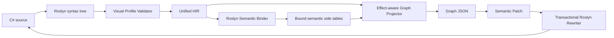

# UnifiedScript Architecture

## Purpose

UnifiedScript provides one gameplay language with two authoring projections:
restricted C# text and a structured visual graph. Both projections must preserve
semantic identity and ultimately execute the same compiled method body.

The system is being developed outside Unreal Engine first. This keeps Roslyn,
HIR, graph projection, and deterministic serialization fast to build and test.
UE integration will be a consumer of these contracts rather than their owner.

## Non-negotiable decisions

### C# is the text surface

The project uses actual C# syntax and Roslyn. It does not inherit JavaScript
runtime semantics and does not create a new parser in the first phase.

### Visual C# is an explicit profile

Only methods marked `[Visual]` promise lossless visual projection. Unsupported
syntax is diagnosed before lowering. Ordinary C# library methods may later be
exposed as opaque call nodes when their signatures use graph-safe types.

### HIR is the shared semantic contract

The graph is projected from HIR, not from IL. Future graph edits will apply
semantic patches to HIR and then construct localized Roslyn syntax changes.

Bound semantics are stored as deterministic side tables keyed by HIR
`SemanticId`. This preserves a language-neutral HIR while attaching resolved
types, declaration references, exact methods, and effects without leaking
Roslyn symbols into downstream modules.

### IDs flow through every layer

Every declaration, statement, expression, graph node, future MIR operation, and
future bytecode range carries a `SemanticId`. Profile v0.1 derives deterministic
IDs from source identity and syntax locations. A persistent identity sidecar is
planned before general structural graph editing so IDs survive unrelated
insertions. Its file contract and reconciliation rules are specified in
[IDENTITY_SIDECAR.md](IDENTITY_SIDECAR.md).

## Current pipeline

## Project boundaries

### UnifiedScript.Core

- `VisualAttribute`
- stable identity
- source positions
- diagnostics
- HIR declarations, statements, and expressions
- HIR traversal and the language-neutral semantic patch contract
- common JSON conventions

This project has no Roslyn, graph UI, CLR hosting, or UE dependency.

### UnifiedScript.CSharp

- Roslyn parsing
- detection of `[Visual]` methods
- Visual Profile validation
- syntax-to-HIR lowering
- source range and deterministic ID assignment
- deterministic multi-document `CSharpCompilation` hosting
- Roslyn symbol/type/method translation into bound semantics
- transactional semantic-patch validation and localized source rewriting

It may depend on Core and Roslyn, but not on Graph or UE.

### UnifiedScript.Semantics

- primitive and nominal type descriptors
- nullability annotations
- exact method descriptors and parameter types
- graph-safe signature classification
- pure/impure/latent effect flags
- HIR-node bindings for declarations, references, types, and calls
- versioned deterministic semantic JSON

It depends only on Core. It must never expose `ITypeSymbol`, `IMethodSymbol`,
CoreCLR hosting objects, or UE reflection objects. Roslyn and future UE adapters
translate into this contract.

### UnifiedScript.Graph

- graph document schema
- data and control ports
- deterministic HIR projection
- graph JSON serialization

It depends on Core and Semantics. This lets later frontends render a typed,
effect-aware graph without hosting Roslyn.

### UnifiedScript.Cli

- filesystem input/output
- diagnostics rendering
- HIR, bound semantics, and graph artifact emission

The CLI is a test harness and integration boundary, not the final editor.

## Profile v0.1

Accepted statement forms:

- block
- one local declaration per statement
- expression statement
- `if/else`
- `return`

Accepted expression forms:

- literals and identifiers
- `this`
- member access
- invocation
- binary and prefix unary operators
- assignment
- cast
- `await`

Explicitly rejected forms include dynamic binding, unsafe code, pointers, goto,
yield, local functions, lambdas, exception control flow, locks, LINQ query
syntax, stack allocation, ref/out/in parameters and arguments, generic visual
methods, loops, switch, and all other syntax not listed above.

## Graph semantics

The current graph schema separates control edges from data edges. Statement
nodes participate in control flow; expression nodes form data dependencies.
Pure expression statements use an explicit `Evaluate` control node. Effectful
calls, assignments, and awaits instead expose their own control ports, so nested
side effects are sequenced before their data consumers.

The first semantic slice now classifies Roslyn builtin operators and
`System.Math`/`System.MathF` calls as pure. Unknown calls default to
`ReadsState | WritesState`; task-like or async calls additionally become
`Async | Latent`. Effectful calls, assignments, and awaits receive explicit
control ports and are sequenced in C# evaluation order. Versioned effect catalog
rules can override method effects without introducing Roslyn dependencies into
the semantic contract.

`CSharpCompilationRequest` canonicalizes source order, rejects duplicate logical
paths, fingerprints explicit metadata references, and carries the effect
catalog. Multi-document HIR compilation identity depends on assembly name,
logical paths, and source digests. Bound semantics additionally carry a
configuration ID so the same source analyzed with different references or
effect rules cannot be mistaken for the same semantic result.

Single- and multi-document HIR compilation IDs now both include assembly name,
logical source paths, and SHA-256 source digests. This content-sensitive ID is
the optimistic-concurrency baseline for graph-to-source patches; path-only
compilation identity is not safe for editing.

## Semantic patch transaction

Graph schema v0.2 carries both the source compilation ID and semantic
configuration ID. A `unifiedscript.patch/v0.1` document repeats those IDs and
contains typed operations keyed by graph/HIR `SemanticId`. The first operation
is `replaceLiteral`, with expected-old-value and proposed-new-value fields.

The C# patch boundary performs these steps without mutating files:

1. analyze the current source request;
2. verify source and semantic-configuration baselines;
3. resolve every target ID to the expected HIR node kind;
4. verify operation-specific preconditions;
5. build localized Roslyn syntax replacements while preserving trivia;
6. apply every operation in memory;
7. rerun profile validation, compilation, semantic binding, and graph safety;
8. return patched documents only if the complete transaction succeeds.

The CLI currently writes a successful single-document result through a
same-directory temporary file and atomic move. Failed patches produce no output
source. Persistent `.usids` reconciliation is deliberately separate: the
bootstrap span-derived ID can change after a value-length edit, so structural
editing remains blocked until the identity sidecar is implemented.

Visual method signatures currently accept void, booleans, integer and floating
primitives, strings, enums, nullable forms of supported value types, and
task-like wrappers with safe results. Arbitrary classes, interfaces, delegates,
arrays, type parameters, and user structs are rejected with `UVS2001` when used
as visual parameters or return values. They may still appear internally as
receivers until a richer graph-safe object-handle policy is defined.

## Error strategy

- Syntax errors stop HIR emission.
- Visual Profile errors stop HIR emission.
- Unsupported syntax always has a stable `UVS` diagnostic code.
- Compiler or semantic errors stop bound semantics and graph emission.
- Graph-unsafe visual signatures produce stable `UVS2001` diagnostics.
- The CLI does not emit partial artifacts after an error.
- Lowering throws only when validator and lowerer support lists disagree; that is
  an implementation defect covered by tests, not a user-facing failure mode.

## Testing strategy

- identity determinism tests;
- one test per profile diagnostic family;
- C#-to-HIR structural tests;
- HIR-to-graph control/data tests;
- deterministic serialization tests;
- golden digests for versioned HIR, semantics, and graph fixtures;
- later, golden source/graph/source round-trip tests;
- later, semantic equivalence tests between graph-edited and text-edited IL.

## Deferred UE boundary

UE binding is deliberately absent. When introduced, it will provide:

- a UE reflection symbol catalog consumed by semantic binding;
- graph-safe type mappings;
- generated C++/C# call thunks;
- world-scoped runtime domains;
- UObject lifetime bridges;
- editor graph rendering and transactions.

None of these concerns may redefine HIR semantics implicitly.

## Current semantic-host boundary

The M2 host compiles one or more source documents against runtime trusted
platform assemblies, `UnifiedScript.Core`, and optional explicit metadata
references. It does not yet load a `.csproj`, resolve NuGet assets, run source
generators, or import UE symbol assemblies. MSBuild/project loading remains a
CLI adapter concern; downstream Semantics and Graph modules continue to consume
the same compilation-neutral contracts.
