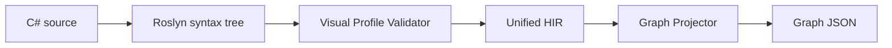

# UnifiedScript Architecture

## Purpose

UnifiedScript provides one gameplay language with two authoring projections:
restricted C# text and a structured visual graph. Both projections must preserve
semantic identity and ultimately execute the same compiled method body.

The system is being developed outside Unreal Engine first. This keeps Roslyn,
HIR, graph projection, and deterministic serialization fast to build and test.
UE integration will be a consumer of these contracts rather than their owner.

## Non-negotiable decisions

### C# is the text surface

The project uses actual C# syntax and Roslyn. It does not inherit JavaScript
runtime semantics and does not create a new parser in the first phase.

### Visual C# is an explicit profile

Only methods marked `[Visual]` promise lossless visual projection. Unsupported
syntax is diagnosed before lowering. Ordinary C# library methods may later be
exposed as opaque call nodes when their signatures use graph-safe types.

### HIR is the shared semantic contract

The graph is projected from HIR, not from IL. Future graph edits will apply
semantic patches to HIR and then construct localized Roslyn syntax changes.

### IDs flow through every layer

Every declaration, statement, expression, graph node, future MIR operation, and
future bytecode range carries a `SemanticId`. Profile v0.1 derives deterministic
IDs from source identity and syntax locations. A persistent identity sidecar is
planned before interactive graph editing so IDs survive unrelated insertions.
Its file contract and reconciliation rules are specified in
[IDENTITY_SIDECAR.md](IDENTITY_SIDECAR.md).

## Current pipeline

## Project boundaries

### UnifiedScript.Core

- `VisualAttribute`
- stable identity
- source positions
- diagnostics
- HIR declarations, statements, and expressions
- common JSON conventions

This project has no Roslyn, graph UI, CLR hosting, or UE dependency.

### UnifiedScript.CSharp

- Roslyn parsing
- detection of `[Visual]` methods
- Visual Profile validation
- syntax-to-HIR lowering
- source range and deterministic ID assignment

It may depend on Core and Roslyn, but not on Graph or UE.

### UnifiedScript.Graph

- graph document schema
- data and control ports
- deterministic HIR projection
- graph JSON serialization

It depends only on Core. This lets later frontends render the same graph without
hosting Roslyn.

### UnifiedScript.Cli

- filesystem input/output
- diagnostics rendering
- HIR and graph artifact emission

The CLI is a test harness and integration boundary, not the final editor.

## Profile v0.1

Accepted statement forms:

- block
- one local declaration per statement
- expression statement
- `if/else`
- `return`

Accepted expression forms:

- literals and identifiers
- `this`
- member access
- invocation
- binary and prefix unary operators
- assignment
- cast
- `await`

Explicitly rejected forms include dynamic binding, unsafe code, pointers, goto,
yield, local functions, lambdas, exception control flow, locks, LINQ query
syntax, stack allocation, ref/out/in parameters and arguments, generic visual
methods, loops, switch, and all other syntax not listed above.

## Graph semantics

The current graph schema separates control edges from data edges. Statement
nodes participate in control flow; expression nodes form data dependencies.
Expression statements use an explicit `Evaluate` control node so an invocation
can be represented as a value expression without prematurely deciding its UE
purity or effect classification.

Semantic binding and an effect system will later classify calls as pure,
impure, latent, authority-only, game-thread-only, or editor-only.

## Error strategy

- Syntax errors stop HIR emission.
- Visual Profile errors stop HIR emission.
- Unsupported syntax always has a stable `UVS` diagnostic code.
- The CLI does not emit partial artifacts after an error.
- Lowering throws only when validator and lowerer support lists disagree; that is
  an implementation defect covered by tests, not a user-facing failure mode.

## Testing strategy

- identity determinism tests;
- one test per profile diagnostic family;
- C#-to-HIR structural tests;
- HIR-to-graph control/data tests;
- deterministic serialization tests;
- later, golden source/graph/source round-trip tests;
- later, semantic equivalence tests between graph-edited and text-edited IL.

## Deferred UE boundary

UE binding is deliberately absent. When introduced, it will provide:

- a UE reflection symbol catalog consumed by semantic binding;
- graph-safe type mappings;
- generated C++/C# call thunks;
- world-scoped runtime domains;
- UObject lifetime bridges;
- editor graph rendering and transactions.

None of these concerns may redefine HIR semantics implicitly.
