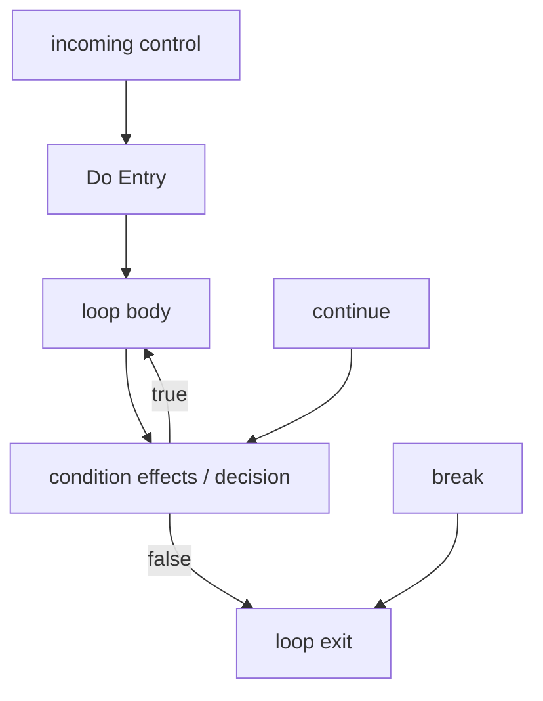

# Lossless and Graph-Authored Do-While Loops

M4.19 adds C# `do ... while` as an independent structured loop across text,
HIR, semantic binding, Graph, derived CFG, persistent identity, exact source
editing, and visual construction. It is not lowered to `while`: a post-test
loop executes its body at least once, and changing that order would change the
program.

The strict-reader contracts for this slice are:

- HIR `unifiedscript.hir/v0.9`;
- Graph `unifiedscript.graph/v0.13`;
- standalone patch `unifiedscript.patch/v0.28`;
- patch plan `unifiedscript.patch-plan/v0.21`.

## HIR contract

HIR serializes the statement with discriminator `doWhile`:

```text
HirDoWhileStatement
├── Body
└── Condition
```

The child order is intentional. Traversal, structural fingerprints, and
identity reconciliation see the body before the condition, matching both
source order and the first execution order. `HirDoWhileStatement` remains
distinct from `HirWhileStatement`, so downstream tools do not need to infer
post-test behavior from source spans or labels.

The Visual C# profile admits `DoStatementSyntax`. A `break` or `continue` may
bind to an enclosing `while`, `do`, `for`, or supported `foreach`; the nearest lexical loop remains
authoritative. Roslyn continues to own condition typing and name binding.

## Graph execution shape

A do-while owns one `loop` region and one `loopBody` child, like a while, but
its control topology is different. Graph v0.12 creates a generated `loopEntry`
control node for the one-time initial body entry and uses the ordinary `loop`
node only for the condition decision after the body.



The loop node publishes the machine-readable contract:

```json
{
  "kind": "loop",
  "label": "Do While",
  "properties": {
    "loopForm": "doWhile",
    "conditionEvaluation": "afterBody",
    "continueTarget": "condition",
    "evaluationOrder": "body,condition"
  }
}
```

The generated entry node has `phase: initialBodyEntry`. It is a real control
node rather than a second input port on the decision node. CFG analysis works
at node granularity, so two semantically different entries on one decision
node would incorrectly make the false exit reachable before the first body
execution.

Condition expressions use the same effect projection as while and for
conditions. If the condition has effects, body fallthrough and `continue`
target the first condition-effect node; otherwise they target the loop decision
node. The condition value still feeds the loop's `condition` data port.

## Derived CFG facts

For a non-empty do-while, `GraphControlFlowLoop` reports:

- `HeaderEntryNodeId`: the first control node in the body, which is the natural
  cyclic header and receives both the one-time entry and the condition-true
  back edge;
- `BodyEntryNodeId`: the same first body control node;
- `ContinueTargetNodeId`: the first condition effect or the loop decision;
- `ExitNodeId`: the statement after the loop or the synthetic function exit;
- `BackEdgeArcIds`: condition-true arcs returning to the body header;
- nearest-loop break and continue node IDs.

An empty body is still valid. In that shape the initial entry flows directly
to the condition, the condition-true edge returns to that same effective
header, and the CFG remains reducible. Initial entry is deliberately excluded
from the cyclic component.

These facts make the three critical claims independently testable:

1. there is no initial edge that can evaluate the condition before the body;
2. `continue` evaluates the condition instead of jumping straight to the body;
3. a true condition returns to the body while a false condition exits.

## Exact condition editing

Patch v0.20 adds `replaceDoWhileCondition`. Its preconditions include:

- the exact `HirDoWhileStatement` ID;
- the current condition root ID;
- the current Boolean semantic type ID;
- a closed, typed replacement expression.

The source rewriter replaces only `DoStatementSyntax.Condition`. It preserves
the loop statement and body identities, rejects meaningful trivia that would
be discarded, resolves local references against the same-method scope and CFG,
and reruns profile, compiler, semantic, HIR, Graph, and CFG validation before
committing source.

Patch JSON uses:

```json
{
  "operation": "replaceDoWhileCondition",
  "targetNodeId": "...",
  "expectedConditionNodeId": "...",
  "expectedConditionTypeId": "...",
  "newCondition": { "expression": "literal", "valueText": "false", "expectedTypeId": "..." }
}
```

## Visual construction and produced handles

`DoWhilePatchStatement` uses statement discriminator `doWhile` and one typed
Boolean condition. The source builder emits an ordinary Roslyn
`DoStatementSyntax` with an explicit empty block. A plan can then append
supported statements through the same `insertLoopBodyStatement` handle used by
other loops.

Plan v0.20 adds `replaceDoWhileCondition` for an existing loop and
`replaceProducedDoWhileCondition` for a loop inserted earlier in the same
transaction. The produced form stores only the producer `stepId`; after every
stage and full reanalysis, the coordinator resolves the actual persistent loop,
body, and current condition IDs and lowers the edit to the standalone patch
operation. No generated semantic ID is predicted by the visual editor.

Do-while producers can appear in a root block, a generated if branch, or
another generated loop body. Their body handles compose recursively with
nested if/while/do/for/foreach statements. Loop transfers always bind to the nearest
reanalyzed HIR loop.

## Checked-in samples

Analyze the text-authored post-test loop:

```bash
dotnet run --project src/Finare.Cli -- \
  analyze samples/Loops/DoWhileRules.cs \
  --out artifacts/do-while
```

The source covers assignment, `continue`, `break`, and a compound Boolean
condition. Its Graph proves the initial-body and condition-after-body order.

Run the visual construction and produced-condition sample:

```bash
dotnet run --project src/Finare.Cli -- \
  apply-plan \
  samples/Patching/DoWhileBuildRules.cs \
  --identity samples/Patching/DoWhileBuildRules.cs.usids \
  --plan samples/Patching/BuildDoWhile.plan.json \
  --out artifacts/do-while-plan/DoWhileBuildRules.cs \
  --out-identity artifacts/do-while-plan/DoWhileBuildRules.cs.usids
```

The three stages create a do-while, replace its generated condition with
`enabled && (result > 0)`, and append `result = result - 1` to its body.

## Deliberate limits

- The condition is replaced as one exact endpoint; adding/removing a condition
  is impossible because C# do-while always has one.
- Visual construction uses the existing closed scalar expression algebra and
  does not admit arbitrary effectful condition subgraphs.
- Body handles append statements; they do not reorder or move existing source.
- `foreach` is separate. M4.20/M4.21 cover indexed and exact synchronous
  enumerable strategies; pattern/ref/async variants still cannot be
  represented as cosmetic do/while/for metadata. See
  [FOREACH_LOOPS.md](FOREACH_LOOPS.md).
- Exception edges, async state-machine control, SSA, serialized CFG caches, and
  automatic graph placement remain outside M4.19.
