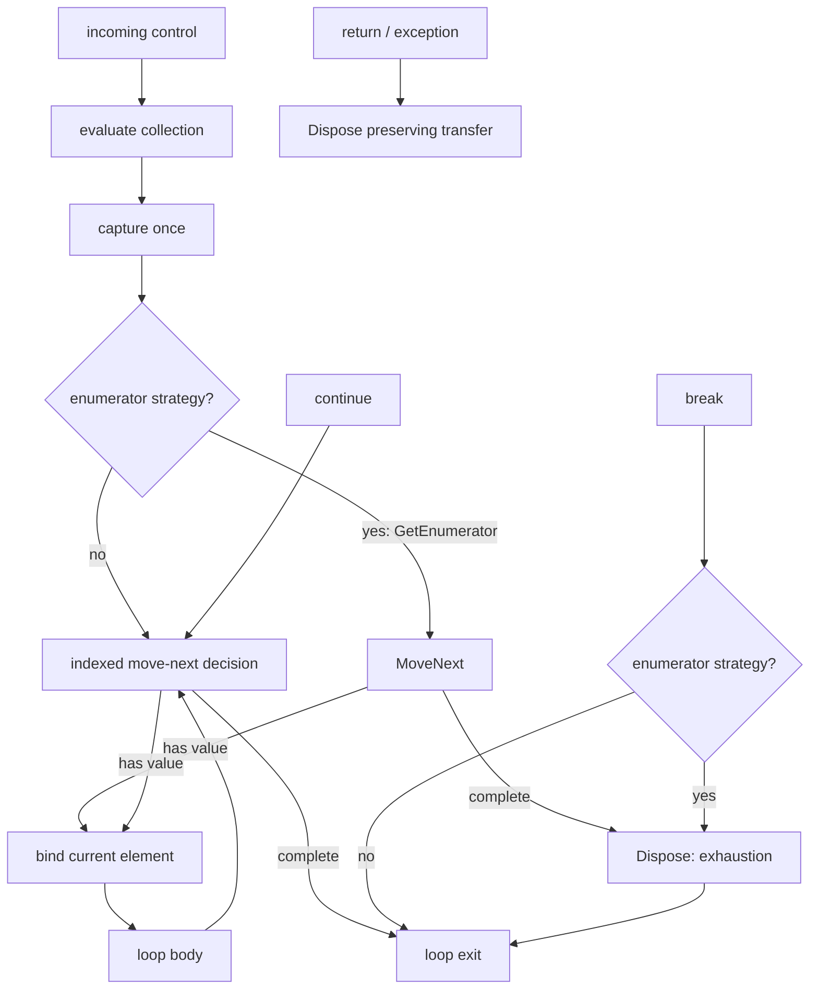

# Foreach Loops and Enumerator Cleanup

M4.20 added exact indexed `foreach`; M4.21 extends the same vertical slice to
synchronous `IEnumerable<T>`-backed collections with explicit enumerator
lifetime and `finally`-equivalent cleanup. Both cover C# text, HIR, semantic
binding, Graph, derived CFG, persistent identity, exact source editing, and
visual construction. Text and visual forms lower to the same contract; there
is no editor-only expansion and no second VM.

The strict-reader contracts for this slice are:

- HIR `unifiedscript.hir/v0.8`;
- semantics `unifiedscript.semantics/v0.2`;
- Graph `unifiedscript.graph/v0.13`;
- standalone patch `unifiedscript.patch/v0.26`;
- patch plan `unifiedscript.patch-plan/v0.21`.

## Supported collection boundary

The current profile accepts two exact strategies:

- indexed: `System.String`, producing `System.Char`, and one-dimensional,
  zero-based arrays whose element type is graph-safe;
- enumerator: a synchronous collection backed by exactly one
  `System.Collections.Generic.IEnumerable<T>` contract, where `T` is
  graph-safe and Roslyn resolves identity conversions plus a disposable
  enumerator protocol.

Both strategies evaluate the collection once, bind the read-only current value
before each body entry, and advance before the next body entry. Indexed loops
use `0 .. Length - 1`. Enumerator loops preserve Roslyn's resolved
`GetEnumerator`, `MoveNext`, `Current`, and `Dispose` symbols and execute
`Dispose` on exhaustion, nearest-loop `break`, `return`, and exceptional exit.

Pattern-only enumerators, multiple or ambiguous generic enumerable element
contracts, multidimensional or non-zero-based arrays, hidden element/current
conversions, non-disposable enumerators, `ref`/`ref readonly foreach`, and
`await foreach` remain rejected. Reporting `disposal: none` for indexed loops
and `disposal: finally` for enumerator loops is an exact semantic distinction,
not a presentation hint.

## HIR and binding contract

HIR uses discriminator `forEach`:

```text
HirForEachStatement
├── Variable
│   ├── Name
│   └── TypeName
├── Collection
└── Body
```

The iteration variable has its own persistent semantic ID. Roslyn remains the
authority for its declared symbol, collection type, element type, and every
reference inside the body. The semantic binder requires the declared variable
type to equal the supported collection element type and emits `UVS2008` when
the collection does not meet either exact boundary. Semantics v0.2 adds
`BoundForEachInfo`: strategy, collection/element/enumerator type IDs, the four
protocol method IDs, and `RequiresDisposal`. Safe enumerable type descriptors
publish `kind: enumerable` and their exact `elementTypeId`.

Traversal, structural identity reconciliation, patch indexing, use/definition
indexing, and expression enumeration all descend through the collection and
body. Formatting or comment-only edits therefore preserve the loop, variable,
collection, body, and unaffected descendant identities through the normal
`.usids` rules.

## Graph execution shape

A foreach owns one `loop` region. Indexed loops have ordered `loopCollection`
and `loopBody` children. Enumerator loops add a third `loopCleanup` child. The
collection child contains the expression, evaluate-once capture, and—when
needed—enumerator acquisition. The body starts with the source-backed current
binding. The cleanup child contains separate disposal nodes for normal/break,
return, and exception transfers.



The loop node publishes machine-readable semantics:

```json
{
  "kind": "loop",
  "label": "Foreach Move Next",
  "properties": {
    "loopForm": "forEach",
    "collectionEvaluation": "once",
    "collectionStrategy": "enumerator",
    "iterationAdvance": "beforeBody",
    "continueTarget": "moveNext",
    "disposal": "finally",
    "cleanupOn": "exhaustion,break,return,exception",
    "evaluationOrder": "collection,getEnumerator,moveNext,current,body,dispose"
  }
}
```

`GraphJson` validates strategy-specific region order, collection capture,
acquisition/current/disposal node cardinality, cleanup reasons, and loop
properties. A malformed document is rejected instead of being interpreted
with an implicit lifetime strategy.

## Derived CFG facts

`GraphControlFlowLoop` records `CollectionRegionId` and, for enumerators,
`CleanupRegionId` plus normal/return/exception cleanup node IDs. Its effective
header and continue target are move-next; its body entry is current binding.
Normal body fallthrough and `continue` return to move-next. Indexed exhaustion
and `break` reach the exit directly; enumerator exhaustion and `break` first
converge on normal disposal. Returns route through return disposal before the
pending transfer continues.

Exceptional cleanup is represented by an explicit cleanup node together with
protected `ExceptionalSourceNodeIds` and the next exceptional-cleanup target.
Those facts stay outside normal CFG arcs, so dominance, SCC, and reducibility
analysis are not polluted by synthetic “every operation throws” arcs while a
later exception-flow analysis still has exact ownership.

This separation proves three properties independently:

1. incoming control evaluates and captures the collection only once;
2. back edges and `continue` cannot reevaluate the collection;
3. every body entry is dominated by a current-value binding;
4. every enumerator exit owns the required disposal transfer without
   reevaluating the collection.

The existing SCC reducibility and nearest-loop transfer validation applies
unchanged. A nested transfer binds to its nearest reanalyzed HIR loop, not to a
client-supplied edge target.

## Exact collection editing

Patch v0.20 exposes `replaceForEachCollection`. It identifies the existing loop,
the exact current collection root, and the expected collection type. The new
collection is a same-method local or parameter reference of exactly the same
supported collection type, including graph-safe enumerable types. The rewriter
changes only the collection syntax, preserves the loop/body/iteration-variable
identities, rejects meaningful
discarded trivia, and reruns profile, compiler, semantic, Graph, and CFG gates.

Plan v0.20 carries both the direct wrapper and
`replaceProducedForEachCollection`. The produced form names an earlier foreach
producer by `sourceStepId`; the coordinator resolves the generated persistent
loop and collection IDs after reanalysis, so a visual client never predicts
them.

## Visual construction and handles

`ForEachPatchStatement` carries an explicit element type/name, its expected
semantic type ID, and a supported collection reference. Construction emits
ordinary Roslyn `ForEachStatementSyntax` with an explicit block. It publishes:

- a symbolic loop-body handle for `insertLoopBodyStatement`; and
- a produced-local handle for the iteration variable inside that body.

The produced local can feed later bounded expressions only where normal scope,
type, reachability, and CFG dominance permit. It cannot escape after the loop.
Root-block, generated-branch, and generated-loop-body producers compose through
the same plan coordinator used by while, do-while, and for.

## Checked-in samples

Analyze the text-authored array loop:

```bash
dotnet run --project src/UnifiedScript.Cli -- \
  analyze samples/Loops/ForEachRules.cs \
  --out artifacts/foreach
```

Run the visual construction sample:

```bash
dotnet run --project src/UnifiedScript.Cli -- \
  apply-plan \
  samples/Patching/ForEachBuildRules.cs \
  --identity samples/Patching/ForEachBuildRules.cs.usids \
  --plan samples/Patching/BuildForEach.plan.json \
  --out artifacts/foreach-plan/ForEachBuildRules.cs \
  --out-identity artifacts/foreach-plan/ForEachBuildRules.cs.usids
```

The three stages create `foreach (char value in primary)`, reconnect the
collection to `fallback`, and append `result = value` through the produced
iteration-variable handle. The output is ordinary C# and reprojects to the
same indexed foreach Graph contract.

Analyze the disposal-aware enumerator sample:

```bash
dotnet run --project src/UnifiedScript.Cli -- \
  analyze samples/Loops/EnumerableForEachRules.cs \
  --out artifacts/enumerable-foreach
```

Build and reconnect an `IEnumerable<int>` loop through the same visual
protocol:

```bash
dotnet run --project src/UnifiedScript.Cli -- \
  apply-plan \
  samples/Patching/EnumerableForEachBuildRules.cs \
  --identity samples/Patching/EnumerableForEachBuildRules.cs.usids \
  --plan samples/Patching/BuildEnumerableForEach.plan.json \
  --out artifacts/enumerable-foreach-plan/EnumerableForEachBuildRules.cs \
  --out-identity artifacts/enumerable-foreach-plan/EnumerableForEachBuildRules.cs.usids
```

That plan creates the loop over `primary`, reconnects it to `fallback`, and
appends `result = value`. Reanalysis proves `disposal: finally` and all three
cleanup transfer nodes.

## Deliberate limits and next slice

- Collection editing replaces the complete collection endpoint; arbitrary
  collection-expression synthesis and nested input editing are not exposed.
- Construction uses explicitly typed iteration variables and supported local
  or parameter collections; deconstruction and `var` authoring are deferred.
- Body handles append bounded statements and do not move or delete source.
- Collection mutation analysis, bounds-check optimization, full exception CFG,
  async state machines, SSA, serialized CFG caches, and automatic placement
  remain outside M4.21.
- Pattern-only enumerators and conditional disposal, `ref` iteration, and
  `await foreach`/`DisposeAsync` remain independent future slices. They must
  extend the shared semantic/Graph/VM contract before the profile accepts
  those forms.
