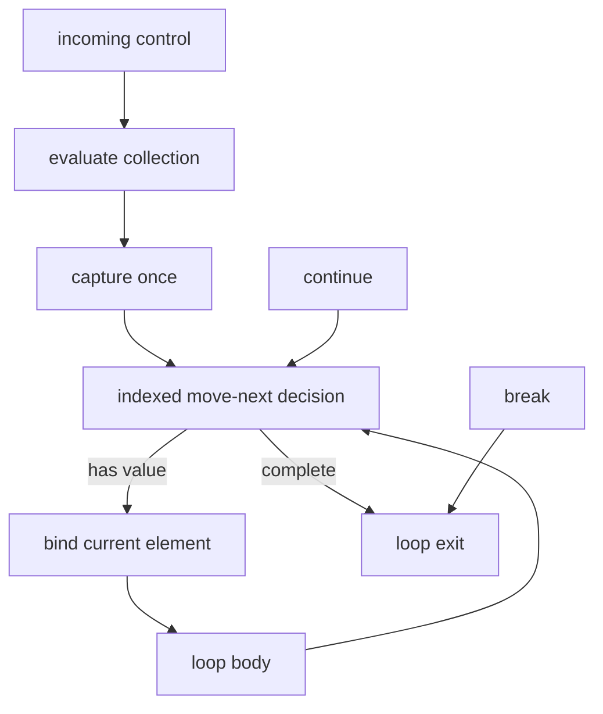

# Indexed Foreach Loops

M4.20 adds a deliberately bounded `foreach` vertical slice across C# text,
HIR, semantic binding, Graph, derived CFG, persistent identity, exact source
editing, and visual construction. Text and visual forms lower to the same HIR
and Graph contract; there is no editor-only expansion and no second VM.

The strict-reader contracts for this slice are:

- HIR `unifiedscript.hir/v0.7`;
- Graph `unifiedscript.graph/v0.11`;
- standalone patch `unifiedscript.patch/v0.18`;
- patch plan `unifiedscript.patch-plan/v0.19`.

## Supported collection boundary

This slice accepts only collection shapes whose iteration semantics can be
represented exactly without an enumerator lifetime:

- `System.String`, producing `System.Char` values; and
- one-dimensional, zero-based arrays whose element type is graph-safe.

The collection is evaluated exactly once. Iteration then follows the indexed
contract `0 .. Length - 1`; the current element is bound before the body, and
the next index is selected before the next body entry. The iteration variable
is read-only and scoped to the loop body.

Generic `IEnumerable<T>`, pattern-based enumerators, multidimensional or
non-zero-based arrays, `ref`/`ref readonly foreach`, and `await foreach` are
rejected. They require explicit enumerator acquisition, `MoveNext`, `Current`,
`Dispose`/`DisposeAsync`, exceptional exits, and `finally` behavior. Reporting
`disposal: none` is therefore an exact statement about the supported indexed
strategy, not an approximation of general C# `foreach`.

## HIR and binding contract

HIR uses discriminator `forEach`:

```text
HirForEachStatement
├── Variable
│   ├── Name
│   └── TypeName
├── Collection
└── Body
```

The iteration variable has its own persistent semantic ID. Roslyn remains the
authority for its declared symbol, collection type, element type, and every
reference inside the body. The semantic binder requires the declared variable
type to equal the supported collection element type and emits `UVS2008` when
the collection does not meet the indexed boundary.

Traversal, structural identity reconciliation, patch indexing, use/definition
indexing, and expression enumeration all descend through the collection and
body. Formatting or comment-only edits therefore preserve the loop, variable,
collection, body, and unaffected descendant identities through the normal
`.usids` rules.

## Graph execution shape

A foreach owns one `loop` region with ordered `loopCollection` and `loopBody`
children. The collection child contains the collection expression and a
generated capture node. The body child starts with the source-backed iteration
variable binding and then owns the body statements.



The loop node publishes machine-readable semantics:

```json
{
  "kind": "loop",
  "label": "Foreach",
  "properties": {
    "loopForm": "forEach",
    "collectionEvaluation": "once",
    "collectionStrategy": "indexed",
    "iterationAdvance": "beforeBody",
    "continueTarget": "moveNext",
    "disposal": "none",
    "evaluationOrder": "collection,moveNext,current,body"
  }
}
```

`GraphJson` validates the region order, generated collection capture, iteration
binding, and all foreach properties. A malformed document is rejected instead
of being interpreted with an implicit loop strategy.

## Derived CFG facts

`GraphControlFlowLoop` records the `CollectionRegionId` in addition to the
ordinary loop/body regions. Its effective header and continue target are the
indexed move-next decision; its body entry is the current-value binding. Normal
body fallthrough and `continue` return to move-next, while loop exhaustion and
nearest-loop `break` converge on the exit successor.

This separation proves three properties independently:

1. incoming control evaluates and captures the collection only once;
2. back edges and `continue` cannot reevaluate the collection;
3. every body entry is dominated by a current-value binding.

The existing SCC reducibility and nearest-loop transfer validation applies
unchanged. A nested transfer binds to its nearest reanalyzed HIR loop, not to a
client-supplied edge target.

## Exact collection editing

Patch v0.18 adds `replaceForEachCollection`. It identifies the existing loop,
the exact current collection root, and the expected collection type. The new
collection is a same-method local or parameter reference of exactly the same
supported collection type. The rewriter changes only the collection syntax,
preserves the loop/body/iteration-variable identities, rejects meaningful
discarded trivia, and reruns profile, compiler, semantic, Graph, and CFG gates.

Plan v0.19 adds both the direct wrapper and
`replaceProducedForEachCollection`. The produced form names an earlier foreach
producer by `sourceStepId`; the coordinator resolves the generated persistent
loop and collection IDs after reanalysis, so a visual client never predicts
them.

## Visual construction and handles

`ForEachPatchStatement` carries an explicit element type/name, its expected
semantic type ID, and a supported collection reference. Construction emits
ordinary Roslyn `ForEachStatementSyntax` with an explicit block. It publishes:

- a symbolic loop-body handle for `insertLoopBodyStatement`; and
- a produced-local handle for the iteration variable inside that body.

The produced local can feed later bounded expressions only where normal scope,
type, reachability, and CFG dominance permit. It cannot escape after the loop.
Root-block, generated-branch, and generated-loop-body producers compose through
the same plan coordinator used by while, do-while, and for.

## Checked-in samples

Analyze the text-authored array loop:

```bash
dotnet run --project src/UnifiedScript.Cli -- \
  analyze samples/Loops/ForEachRules.cs \
  --out artifacts/foreach
```

Run the visual construction sample:

```bash
dotnet run --project src/UnifiedScript.Cli -- \
  apply-plan \
  samples/Patching/ForEachBuildRules.cs \
  --identity samples/Patching/ForEachBuildRules.cs.usids \
  --plan samples/Patching/BuildForEach.plan.json \
  --out artifacts/foreach-plan/ForEachBuildRules.cs \
  --out-identity artifacts/foreach-plan/ForEachBuildRules.cs.usids
```

The three stages create `foreach (char value in primary)`, reconnect the
collection to `fallback`, and append `result = value` through the produced
iteration-variable handle. The output is ordinary C# and reprojects to the
same indexed foreach Graph contract.

## Deliberate limits and next slice

- Collection editing replaces the complete collection endpoint; arbitrary
  collection-expression synthesis and nested input editing are not exposed.
- Construction uses explicitly typed iteration variables and supported local
  or parameter collections; deconstruction and `var` authoring are deferred.
- Body handles append bounded statements and do not move or delete source.
- Collection mutation analysis, bounds-check optimization, exception edges,
  async state machines, SSA, serialized CFG caches, and automatic placement
  remain outside M4.20.
- General enumerator-backed foreach is the next independent slice. It must add
  acquisition, move-next/current operations, disposal regions, normal and
  exceptional cleanup edges, and async variants before those collection shapes
  can be accepted without semantic loss.
