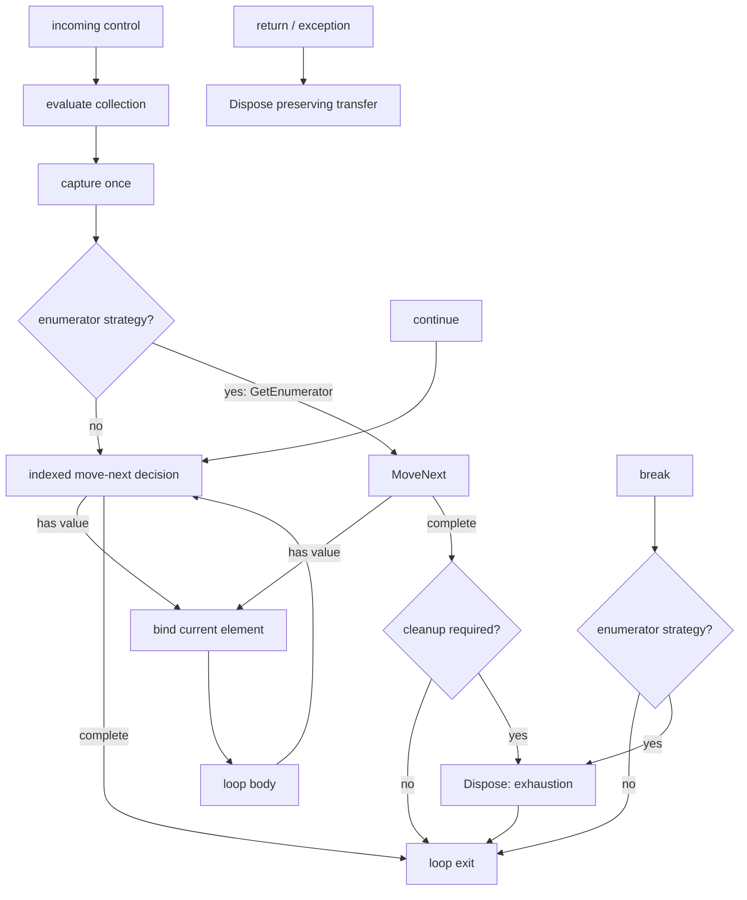

# Foreach Loops and Enumerator Cleanup

M4.20 added exact indexed `foreach`; M4.21 extends the same vertical slice to
synchronous `IEnumerable<T>`-backed collections with explicit enumerator
lifetime and `finally`-equivalent cleanup. M8.5 adds graph-safe pattern
enumerators, exact conditional-disposal classification, and borrowed
`Span<T>`/`ReadOnlySpan<T>` iteration including `ref readonly`. The next M8.5
slice adds `await foreach` over graph-safe `IAsyncEnumerable<T>`, including
awaited move-next and `DisposeAsync` cleanup. These forms
cover C# text, HIR, semantic binding, Graph, derived CFG, persistent identity,
and exact collection editing. Text and visual forms lower to the same contract;
there is no editor-only expansion and no second VM.

The strict-reader contracts for this slice are:

- HIR `unifiedscript.hir/v0.9`;
- semantics `unifiedscript.semantics/v0.5`;
- Graph `unifiedscript.graph/v0.13`;
- standalone patch `unifiedscript.patch/v0.28`;
- patch plan `unifiedscript.patch-plan/v0.21`.

## Supported collection boundary

The current profile accepts three execution strategies and three lifetime modes:

- indexed: `System.String`, producing `System.Char`, and one-dimensional,
  zero-based arrays whose element type is graph-safe;
- enumerator: a synchronous graph-safe `IEnumerable<T>` or pattern collection,
  plus scoped `Span<T>`/`ReadOnlySpan<T>` borrowed sequences, where `T` is
  graph-safe and Roslyn resolves identity element/current conversions.
- async enumerator: a graph-safe `IAsyncEnumerable<T>` or async pattern
  collection with identity element/current conversions. The loop awaits
  `MoveNextAsync` and, when required, `DisposeAsync`.

Both strategies evaluate the collection once, bind the read-only current value
before each body entry, and advance before the next body entry. Indexed loops
use `0 .. Length - 1`. Enumerator loops preserve Roslyn's resolved
`GetEnumerator`, `MoveNext`, and `Current` symbols. When Roslyn's enumerator
requires cleanup, the binding also preserves the exact `Dispose` method and
classifies it as required or runtime-conditional. Cleanup runs on exhaustion,
nearest-loop `break`, `return`, and exceptional exit.

Multiple or ambiguous generic enumerable element contracts, multidimensional
or non-zero-based arrays, hidden element/current conversions, mutable `ref`
iteration, and borrowed references across `await foreach` remain rejected.
Synchronous `ref readonly` is accepted only when Roslyn binds `Current` by
reference. Reporting `disposal: none`, `disposal: finally`,
`disposal: conditionalFinally`, `disposal: asyncFinally`, or
`disposal: conditionalAsyncFinally` is an exact semantic distinction, not a
presentation hint.

## HIR and binding contract

HIR uses discriminator `forEach`:

```text
HirForEachStatement
├── IterationKind: value | ref | refReadOnly
├── IsAsync
├── Variable
│   ├── Name
│   └── TypeName
├── Collection
└── Body
```

The iteration variable has its own persistent semantic ID. Roslyn remains the
authority for its declared symbol, collection type, element type, and every
reference inside the body. The semantic binder requires the declared variable
type to equal the supported collection element type and emits `UVS2008` when
the collection does not meet either exact boundary. Semantics v0.5 carries
`BoundForEachInfo`: strategy, iteration kind, collection/element/enumerator
type IDs, protocol method IDs, and `ForEachDisposalKind`. It adds the
`asyncEnumerator` strategy and `asyncEnumerable` type kind. Safe sync and async
enumerable descriptors publish their exact `elementTypeId`; scoped spans
publish `kind: borrowedSequence` and remain illegal as callable Graph signature
values.

Traversal, structural identity reconciliation, patch indexing, use/definition
indexing, and expression enumeration all descend through the collection and
body. Formatting or comment-only edits therefore preserve the loop, variable,
collection, body, and unaffected descendant identities through the normal
`.usids` rules.

## Graph execution shape

A foreach owns one `loop` region. Indexed and non-disposing enumerator loops
have ordered `loopCollection` and `loopBody` children. Disposing enumerators
add a third `loopCleanup` child. The
collection child contains the expression, evaluate-once capture, and—when
needed—enumerator acquisition. The body starts with the source-backed current
binding and identifies whether the value is copied or borrowed read-only. The
cleanup child contains separate disposal nodes for normal/break, return, and
exception transfers; conditional cleanup nodes also publish
`disposalCondition: runtimeInterface`.



The loop node publishes machine-readable semantics:

```json
{
  "kind": "loop",
  "label": "Foreach Move Next",
  "properties": {
    "loopForm": "forEach",
    "collectionEvaluation": "once",
    "collectionStrategy": "enumerator",
    "iterationAdvance": "beforeBody",
    "continueTarget": "moveNext",
    "disposal": "finally",
    "iterationKind": "value",
    "cleanupOn": "exhaustion,break,return,exception",
    "evaluationOrder": "collection,getEnumerator,moveNext,current,body,dispose"
  }
}
```

`GraphJson` validates strategy-specific region order, collection capture,
acquisition/current/disposal node cardinality, iteration/value semantics,
cleanup condition/reasons, and loop properties. A malformed document is
rejected instead of being interpreted with an implicit alias or lifetime
strategy.

Async loops use `collectionStrategy: asyncEnumerator`,
`continueTarget: moveNextAsync`, and `suspension: moveNextAndDispose` (or
`moveNext` when no cleanup is required). Their acquisition and cleanup nodes
carry the exact `GetAsyncEnumerator`/`DisposeAsync` method IDs. Each async
cleanup node is marked `await: true`, and the three cleanup reasons preserve the
same exhaustion/break, return, and exception ownership as synchronous loops.

## Derived CFG facts

`GraphControlFlowLoop` records `CollectionRegionId` and, for disposing
enumerators, `CleanupRegionId` plus normal/return/exception cleanup node IDs. Its effective
header and continue target are move-next; its body entry is current binding.
Normal body fallthrough and `continue` return to move-next. Indexed exhaustion
and `break` reach the exit directly for indexed/non-disposing loops; disposing
enumerator exhaustion and `break` first converge on normal disposal. Returns
route through return disposal before the pending transfer continues.

Exceptional cleanup is represented by an explicit cleanup node together with
protected `ExceptionalSourceNodeIds` and the next exceptional-cleanup target.
Those facts stay outside normal CFG arcs, so dominance, SCC, and reducibility
analysis are not polluted by synthetic “every operation throws” arcs while a
later exception-flow analysis still has exact ownership.

This separation proves three properties independently:

1. incoming control evaluates and captures the collection only once;
2. back edges and `continue` cannot reevaluate the collection;
3. every body entry is dominated by a current-value binding;
4. every enumerator exit owns the required disposal transfer without
   reevaluating the collection.

The existing SCC reducibility and nearest-loop transfer validation applies
unchanged. A nested transfer binds to its nearest reanalyzed HIR loop, not to a
client-supplied edge target.

## Exact collection editing

Patch v0.20 exposes `replaceForEachCollection`. It identifies the existing loop,
the exact current collection root, and the expected collection type. The new
collection is a same-method local or parameter reference of exactly the same
supported collection type, including graph-safe enumerable and borrowed span
types. Async collections use the same exact `asyncEnumerable` element
contract. The rewriter
changes only the collection syntax, preserves the loop/body/iteration-variable
identities, rejects meaningful
discarded trivia, and reruns profile, compiler, semantic, Graph, and CFG gates.

Plan v0.20 carries both the direct wrapper and
`replaceProducedForEachCollection`. The produced form names an earlier foreach
producer by `sourceStepId`; the coordinator resolves the generated persistent
loop and collection IDs after reanalysis, so a visual client never predicts
them.

## Visual construction and handles

`ForEachPatchStatement` carries an explicit element type/name, its expected
semantic type ID, and a supported collection reference. Construction emits
ordinary Roslyn `ForEachStatementSyntax` with an explicit block. It publishes:

- a symbolic loop-body handle for `insertLoopBodyStatement`; and
- a produced-local handle for the iteration variable inside that body.

The produced local can feed later bounded expressions only where normal scope,
type, reachability, and CFG dominance permit. It cannot escape after the loop.
Root-block, generated-branch, and generated-loop-body producers compose through
the same plan coordinator used by while, do-while, and for.

## Checked-in samples

Analyze the text-authored array loop:

```bash
dotnet run --project src/UnifiedScript.Cli -- \
  analyze samples/Loops/ForEachRules.cs \
  --out artifacts/foreach
```

Run the visual construction sample:

```bash
dotnet run --project src/UnifiedScript.Cli -- \
  apply-plan \
  samples/Patching/ForEachBuildRules.cs \
  --identity samples/Patching/ForEachBuildRules.cs.usids \
  --plan samples/Patching/BuildForEach.plan.json \
  --out artifacts/foreach-plan/ForEachBuildRules.cs \
  --out-identity artifacts/foreach-plan/ForEachBuildRules.cs.usids
```

The three stages create `foreach (char value in primary)`, reconnect the
collection to `fallback`, and append `result = value` through the produced
iteration-variable handle. The output is ordinary C# and reprojects to the
same indexed foreach Graph contract.

Analyze the disposal-aware enumerator sample:

```bash
dotnet run --project src/UnifiedScript.Cli -- \
  analyze samples/Loops/EnumerableForEachRules.cs \
  --out artifacts/enumerable-foreach
```

Build and reconnect an `IEnumerable<int>` loop through the same visual
protocol:

```bash
dotnet run --project src/UnifiedScript.Cli -- \
  apply-plan \
  samples/Patching/EnumerableForEachBuildRules.cs \
  --identity samples/Patching/EnumerableForEachBuildRules.cs.usids \
  --plan samples/Patching/BuildEnumerableForEach.plan.json \
  --out artifacts/enumerable-foreach-plan/EnumerableForEachBuildRules.cs \
  --out-identity artifacts/enumerable-foreach-plan/EnumerableForEachBuildRules.cs.usids
```

That plan creates the loop over `primary`, reconnects it to `fallback`, and
appends `result = value`. Reanalysis proves `disposal: finally` and all three
cleanup transfer nodes.

## Deliberate limits and next slice

- Collection editing replaces the complete collection endpoint; arbitrary
  collection-expression synthesis and nested input editing are not exposed.
- Construction uses explicitly typed iteration variables and supported local
  or parameter collections; deconstruction and `var` authoring are deferred.
- Body handles append bounded statements and do not move or delete source.
- Mutable `ref` construction/editing requires writable alias ports and remains
  rejected; accepted borrowed iteration is explicitly `ref readonly`.
- Visual construction currently emits synchronous foreach syntax; authoring an
  `await foreach` begins in C# and can then use the same exact collection
  replacement path. A dedicated async-construction payload remains deferred.
- Collection mutation analysis, bounds-check optimization, full exception CFG,
  standalone async state-machine lowering, SSA, serialized CFG caches, and automatic placement
  remain outside this slice.
